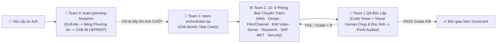

# 🏢 MASTER BLUEPRINT — BỘ NHÂN SỰ AI ANTIGRAVITY INFOASIA (12 PHÒNG BAN · 43 SUBAGENT CỐ ĐỊNH)

> **Căn cứ chuẩn kỹ thuật (Đã đọc & kiểm chứng thực tế HTTP 200):**
> - Tài liệu chính thức: [Custom subagents | Google Antigravity Docs](https://antigravity.google/docs/subagents/)
> - Kho kỹ năng thực tế trên máy: `%USERPROFILE%\.gemini\config\skills\` (**42/42 skills đã ánh xạ đủ 100%, 0 skill bị bỏ sót**)
> - Kiểm chứng Live Plugin Discovery (`GetAllPlugins`): **Toàn bộ 12/12 phòng ban (43/43 subagent, 18 plugin skills, 0 unmapped tools)** đã nạp sống thành công (`Exit code 0`).

---

## 0. Luồng Dây Chuyền Tổng Thể 11 Phòng Ban



---

## 1. Chuẩn Chính Thức Antigravity Subagents (`antigravity.google/docs/subagents/`)

Toàn bộ 39 Subagent được chuẩn hóa theo đúng đặc tả YAML Frontmatter của Google Antigravity:

```yaml
---
name: <ten-subagent-kebab-case>
description: "<Mô tả rõ nhiệm vụ để Agent chính gọi đúng người đúng việc>"
subagent: true
mainAgent: false
model: inherit                 # inherit | flash | pro
commandExecutionPolicy: auto   # sandbox | auto | eager | off
tools:
  - read_file
  - edit_file
  - write_file
  - run_command
  - manage_task
  - search_web
  - invoke_subagent
  - send_message
  - manage_subagents
skills:
  - ../skills/<ten-sop-skill>
---
```

### Nguyên tắc "Giàu Công Cụ Nhưng Chặt QA"
1. **Không để Worker thiếu công cụ mà từ chối việc:** Mọi **Worker thực thi** đều có đủ bộ công cụ (`read_file`, `edit_file`, `write_file`, `run_command`, `manage_task`, `search_web`, `call_mcp_tool`, `invoke_subagent`, `send_message`) + `commandExecutionPolicy: auto` để tự tra cứu, tự gọi MCP (`agy-skill-hub`, `antigravity-tools`, `rea`, `craft-anything`), tự chạy Python313 / `sql_runner.py` / `sshpass` / `paramiko` và tự gọi `browser` / `image-generator`.
2. **Giữ cứng tường lửa QA Độc Lập:** Nhóm **QA / Auditor** (`qa-code-tester`, `qa-visual-human-tester`, `qa-ifixai-auditor`, `infra-qa-security-verifier`, `web-fact-checker`, `design-ux-cro-auditor`, `video-qa-verifier`) vẫn có đủ công cụ chạy test, chụp ảnh & đọc ảnh nhưng **KHÔNG cấp `edit_file` / `write_file`** lên sản phẩm — thấy lỗi là chặn bàn giao (Grade F) và trả Worker sửa lại.
3. **Chống treo subagent (Known Issue từ tài liệu Google):** Mọi tên tool trong `tools:` đều được kiểm chứng `builtin: true` qua `GetAllPlugins` của Language Server trước khi bàn giao.

---

## 2. Bản Đồ 11 Phòng Ban AI (Ánh Xạ Đủ 42/42 Skills Trên Máy)

| # | Plugin Phòng Ban | Trạng thái | Nhân Sự Subagent Cố Định (39 agents) | Model khuyến nghị | Skills trong `config\skills\` được gắn (42/42) |
| :--- | :--- | :---: | :--- | :--- | :--- |
| **Team 0** | **`team-planning-blueprint`** *(Cổng Khởi Tạo: Lên Kế Hoạch, Phỏng Vấn & Chốt Đặc Tả Với Người Dùng TRƯỚC Khi Làm)* | ✅ LIVE (3/3 agents · Cấm code sớm 100%) | 1. `blueprint-interviewer`<br>2. `solution-architect`<br>3. `blueprint-spec-validator` | `pro` / `inherit`<br>`pro` / `inherit`<br>`flash` | `project-blueprint-architect` *(đã gồm `obra/superpowers`, `mattpocock/skills`, `github/spec-kit`, `pm-skills` + `validate_blueprint.py`)* *(1)* |
| **Team 1** | **`team-orchestrator-qa`** *(Bộ Chỉ Huy Chia Nhỏ Việc, Chống Ảo Giác & QA Đa Tầng)* | ✅ LIVE (Chuẩn YAML Google) | 4. `orchestrator-planner`<br>5. `qa-code-tester`<br>6. `qa-visual-human-tester`<br>7. `qa-ifixai-auditor` | `pro` / `inherit`<br>`flash`<br>`flash`<br>`pro` / `inherit` | `lean-teamwork`, `ifixai-agent-auditor`, `agency-agents`, `prompts-chat`, `nap-tai-lieu-antigravity` *(5)* |
| **Team 2** | **`team-web-wordpress-seo`** *(Phát Triển Web, WordPress/Flatsome, Landing Page & SEO/GEO)* | ✅ LIVE (Chuẩn YAML Google) | 8. `web-wp-builder`<br>9. `web-landingpage-coder`<br>10. `web-seo-geo-specialist`<br>11. `web-performance-auditor` | `inherit`<br>`inherit`<br>`flash`<br>`flash` | `wordpress-flatsome-designer`, `design-landingpage-vip-v2`, `html-to-webcake`, `claude-seo` *(4)* |
| **Team 3** | **`team-design-creative`** *(🆕 TEAM DESIGN THIẾT KẾ: Thương Hiệu CIP, Logo SVG, UI/UX, Banner Ads, Dàn Trang In Ấn & Motion Web)* | ✅ LIVE (Chuẩn YAML Google) | 12. `design-brand-identity` *(Logo SVG, CIP, Banner Ads, Báo giá, Tạp chí, PDF/DOCX/PPTX/Typst)*<br>13. `design-ui-ux-architect` *(UI/UX 192 ngành, 79 styles, 84 DESIGN.md, Web/Mobile App UX)*<br>14. `design-visual-asset-creator` *(Tạo ảnh/mockup qua `image-generator`, GSAP animation 60fps)*<br>15. `design-ux-cro-auditor` *(Kiểm toán UI/UX, Responsive Mobile/Desktop, WCAG 2.2 & CRO)* | `inherit`<br>`inherit`<br>`flash`<br>`flash` | `brand-editorial-graphic-studio`, `ui-ux-design-pro-max`, `webapp-app-ux-workflow`, `ui-ux-cro-auditor`, `gsap-skills` *(5)* |
| **Team 4** | **`team-video-film-channel`** *(Sản Xuất Phim AI, Biên Kịch Drama/YouTube & Xây Kênh MXH)* | ✅ LIVE (Chuẩn YAML Google) | 16. `film-scriptwriter`<br>17. `film-prompt-director`<br>18. `film-studio-producer`<br>19. `channel-growth-automation` | `inherit`<br>`inherit`<br>`flash`<br>`flash` | `lam-phim-video-master`, `video-storytelling`, `viet-kich-ban-drama`, `viet-prompt-lam-phim-drama`, `cinematic-video-prompt`, `renderlongytb`, `rendershortvideo`, `shopee-affiliate-video-studio`, `yt-shortcode-commander`, `antigravity-browser-controller` *(10)* |
| **Team 5** | **`team-video-editing-motion`** *(🆕 TEAM EDIT VIDEO & HẬU KỲ CODE/MOTION: Local Studio, Remotion, Motion Canvas, Manim, FFmpeg, Kinetic Reel, Hoạt Hình & Tutorial)* | ✅ LIVE (Chuẩn YAML Google) | 20. `video-editor-ffmpeg` *(Edit local `:5186` 28 style HTML→MP4, Auto-Editor, Editly, FFmpeg, lồng tiếng AI, xuất hàng loạt)*<br>21. `video-motion-coder` *(Remotion, Motion Canvas, Manim, Kinetic Reel WebGL, Painted Animation p5.js)*<br>22. `video-tutorial-producer` *(Quay màn hình Recordly, giọng đọc AI, phụ đề `.SRT`, Auto-Zoom)*<br>23. `video-qa-verifier` *(Kiểm tra `ffprobe` FPS/Audio/Resolution, đếm CSV `utf-8-sig`, trích frame PNG đọc ảnh bằng `read_file`)* | `inherit`<br>`inherit`<br>`flash`<br>`flash` | `create-and-edit-video`, `ai-video-studio`, `kinetic-reel`, `painted-animation`, `recordly-tutorial-ai` *(5)* |
| **Team 6** | **`team-server-vps-hosting`** *(Windows Server, Linux VPS Ubuntu, Hosting, DirectAdmin)* | ✅ LIVE (Chuẩn YAML Google) | 24. `infra-linux-vps` *(`sshpass` + `paramiko 5.0.0`)*<br>25. `infra-windows-server`<br>26. `infra-directadmin-hosting`<br>27. `infra-qa-security-verifier` | `inherit`<br>`inherit`<br>`inherit`<br>`flash` | `server-vps-sop`, `security-audit` *(dùng chung)* |
| **Team 7** | **`team-web-research`** *(Tra Cứu Web, Học Thuật, Khoa Học & Huyền Học)* | ✅ LIVE (Chuẩn YAML Google) | 28. `web-search-scout`<br>29. `web-fact-checker`<br>30. `web-synthesis-editor` | `flash`<br>`inherit`<br>`inherit` | `verified-source-researcher`, `deeptutor-cli`, `tu-vi-bat-tu-than-so-hoc` *(3)* |
| **Team 8** | **`team-sap-b1-sql`** *(ERP SAP Business One, Beas & Kế Toán SQL)* | ✅ LIVE (Chuẩn YAML Google) | 31. `sap-b1-architect`<br>32. `sap-sql-developer`<br>33. `sap-accounting-auditor` | `inherit`<br>`inherit`<br>`pro` / `inherit` | `sap-b1-beas`, `sql-sap-b1`, `viet-sql-sap-b1` *(3)* |
| **Team 9** | **`team-marketing-ads`** *(Marketing, Facebook/Google Ads & Sản Phẩm Số)* | ✅ LIVE (Chuẩn YAML Google) | 34. `mkt-persona-strategist`<br>35. `ads-performance-specialist`<br>36. `mkt-copy-offer-creator` | `inherit`<br>`inherit`<br>`inherit` | `chan-dung-khach-hang-9-phan`, `google-ads-master`, `tao-san-pham-so-bang-ai` *(3 + `cong-thuc-viet-content-by-noti-v4` từ plugin sẵn)* |
| **Team 10** | **`team-reverse-security`** *(Dịch Ngược Phần Mềm, Clean-Room & Bảo Mật)* | ✅ LIVE (Chuẩn YAML Google) | 37. `rev-binary-analyst`<br>38. `rev-cleanroom-builder`<br>39. `sec-vulnerability-auditor` | `pro` / `inherit`<br>`inherit`<br>`pro` / `inherit` | `reverse-engineer-anything`, `craft-anything`, `security-audit` *(3)* |
| **Team 11** | **`custom-local-plugin`** *(🆕 TEAM CHUYÊN TRÁCH `<LOCAL_AUTOMATION_APP>`: Sửa Code Backend/Stealth MV3/UI & Chạy Dàn Thiết Bị Nuôi 24/7)* | ✅ LIVE (Chuẩn YAML Google) | 40. `adsa-core-engineer` *(FastAPI `:8088`, Extension MV3, Proxy/WebRTC, WASAPI 5%, HWID License & `.pyc` Packager)*<br>41. `adsa-nurture-ui-builder` *(Kịch bản YouTube US, 4-Gmail Mesh, FB cá nhân & Frontend UI)*<br>42. `adsa-fleet-operator` *(Trực chiến `:8088`, chống `10048`/`0xE0000008`, gia hạn HomeProxy & bật/tắt ca nuôi)*<br>43. `adsa-qa-stealth-auditor` *(QA độc lập Read-Only: test `HTTP 200`, `Exit code 0`, rà chống lộ IP/Code & chấm Scorecard)* | `inherit`<br>`inherit`<br>`flash`<br>`flash` | `antidetect-automator-sop`, `antigravity-browser-controller`, `yt-shortcode-commander` *(dùng chung)* |

> **Kiểm đếm khớp 100%:** `1 + 5 + 4 + 5 + 10 + 5 + 3 + 3 + 3 + 3 = 42/42 skills` trong `%USERPROFILE%\.gemini\config\skills\`.

---

## 3. Danh Mục Repo Training Bổ Sung *(Đã Xác Minh HTTP 200 & Số Sao Thực Tế Ngày 19/11/2026)*

> *(Ghi chú: `obra/superpowers`, `mattpocock/skills`, `github/spec-kit` và `product-on-purpose/pm-skills` đã có sẵn trong `skills/project-blueprint-architect/` nên Team 0 tận dụng trực tiếp, không cài trùng.)*

| Phòng ban được bổ sung | Repo GitHub đề xuất | Số sao & Cập nhật (API GitHub thật) | Giá trị nâng cấp trực tiếp |
| :--- | :--- | :--- | :--- |
| **Team 1 (QA Mắt Thật)** | **[microsoft/playwright-mcp](https://github.com/microsoft/playwright-mcp)** | ⭐ **39,874** · `2026-11-18` | Công cụ MCP chính chủ Microsoft cho `qa-visual-human-tester` click, điền form, bắt lỗi console & chụp ảnh 3 viewport. |
| **Team 1 (QA Checklist)** | **[petrkindlmann/qa-skills](https://github.com/petrkindlmann/qa-skills)** | ⭐ **289** · `2026-11-16` | 50 `SKILL.md` chuyên sâu về kiểm thử E2E, API testing và visual regression. |
| **Team 2 (WordPress)** | **[WordPress/agent-skills](https://github.com/WordPress/agent-skills)** | ⭐ **2,386** · `2026-11-16` | Repo chính thức tổ chức **WordPress**: `wp-block-themes`, `wp-plugin-development`, `wp-rest-api`, `wp-wpcli-and-ops`, `wp-performance`. |
| **Team 3 (Design Thiết Kế)** | **[anthropics/skills](https://github.com/anthropics/skills)** & **[nextlevelbuilder/ui-ux-pro-max-skill](https://github.com/nextlevelbuilder/ui-ux-pro-max-skill)** | ⭐ **197,414** (`2026-11-16`) & ⭐ **151,511** (`2026-11-19`) | Bộ skill chuẩn `frontend-design`, `canvas-design`, `brand-guidelines`, `pptx/pdf/docx` + cập nhật mới nhất cho hệ UI/UX Design. |
| **Team 5 (Edit Video & Motion)** | **[remotion-dev/skills](https://github.com/remotion-dev/skills)** | ⭐ **7,526** · `2026-11-18` | Repo chính chủ **Remotion**: `/remotion-best-practices`, `/remotion-create`, `/remotion-render` giúp `video-motion-coder` dựng & render video MP4 cực chuẩn. |
| **Team 6 (Server/VPS/DevOps)** | **[akin-ozer/cc-devops-skills](https://github.com/akin-ozer/cc-devops-skills)** & **[chaterm/terminal-skills](https://github.com/chaterm/terminal-skills)** | ⭐ **342** (`2026-07-26`) & ⭐ **60** (`2026-03-03`) | Runbook & validator Nginx, Apache, Systemd, Docker, Linux networking an toàn cho `infra-linux-vps`. |
| **Team 9 (Marketing/Growth)** | **[alirezarezvani/claude-skills](https://github.com/alirezarezvani/claude-skills)** & **[VoltAgent/awesome-agent-skills](https://github.com/VoltAgent/awesome-agent-skills)** | ⭐ **30,099** (`2026-11-19`) & ⭐ **37,340** (`2026-11-15`) | Nguồn trích chọn lọc từng skill rời (tránh cài ồ ạt gây phình context). |
