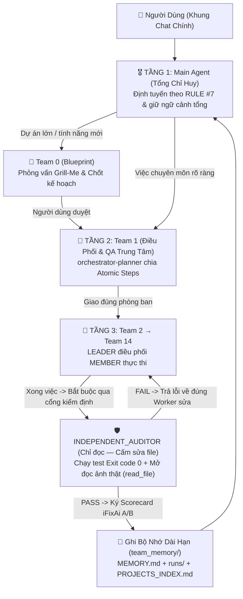

# 🏛️ README — HỆ THỐNG ĐA TÁC TỬ 16 TEAM (59 SUBAGENTS) ANTIGRAVITY × JAVISOS

> **Phiên bản:** `v2.3` · **Cập nhật:** `28/11/2026` · **Vị trí cài đặt trên máy:** `%USERPROFILE%\.gemini\config\`
> **Quy mô chuẩn hóa:** **16 Phòng Ban (`plugins\team-*`)** · **59 Subagents cố định** · **41 Global Skills chuyên môn** · **6 Workflows tự động** · **Bộ nhớ dài hạn 5 lớp + Hook `SessionStart` & `PreInvocation`**
>
> 🚀 **CÀI SANG MÁY MỚI TRONG 2 PHÚT:** Đọc **[HUONG_DAN_CAI_DAT_MAY_MOI.md](./HUONG_DAN_CAI_DAT_MAY_MOI.md)** *(đủ danh sách phần mềm `winget` & thư viện Python)* → chạy **`CAI_DAT_1_CLICK_WINDOWS.bat`** → chạy **`CAI_THU_VIEN_PYTHON_CHO_SKILLS.bat`** (`requirements.txt`).

---

## 1. LOGIC & CƠ CHẾ HOẠT ĐỘNG CỦA HỆ THỐNG TEAM SUBAGENT

### 1.1. Kiến trúc 3 tầng điều phối (Ai chỉ huy ai?)


### 1.2. Vòng đời 5 bước của 1 phiên làm việc (Vì sao AI không quên & không làm ẩu?)
1. **Khi mở hội thoại mới (`+ New Conversation`) — Hook `SessionStart` chạy ĐÚNG 1 LẦN:**
   - Script `scripts\session_memory_loader_hook.py` tự đọc danh bạ dự án đang làm (`team_memory\PROJECTS_INDEX.md`) và **tự nhận diện phòng ban khớp với thư mục workspace anh đang mở** (vd: mở `Xây Kênh Youtube` → tự gợi ý `team-youtube-factory`; mở `Shopee_KOL_Studio_Tool` → tự gợi ý `team-short-video-affiliate`).
2. **Trước mỗi lượt AI suy nghĩ — Hook `PreInvocation` chạy nhẹ (`792` ký tự):**
   - Script `scripts\auto_reanchor_hook.py` nhắc 5 Chốt chặn chống ảo giác + gọi chỉ mục lai **SQLite WAL FTS5 + RRF** (`agy_skill_index.db`, ~5ms) gợi ý đúng Skill & số dòng cần đọc.
3. **Kế thừa 2 tầng tri thức (Không phình prompt):**
   - Mỗi Subagent chỉ giữ file hướng dẫn nhỏ gọn (`3–5 KB < 24 KB`), tự đọc **SOP riêng** (`../skills/<sop>`), **Global Skills** (`skills/*`), **Bộ nhớ dài hạn** (`team_memory/teams/<team>/MEMORY.md` + `team_memory/agents/<slug>/MEMORY.md`) và **Tài liệu nguồn ghim cứng** (`pinned_paths` trong `teams_manifest.json`).
4. **Tường lửa QA Độc Lập (`No Self-Grading`):**
   - Mọi `INDEPENDENT_AUDITOR` (`qa-code-tester`, `qa-visual-human-tester`, `qa-ifixai-auditor`, `yt-production-qa`, `skill-security-qa`, `short-video-qa-auditor`...) bị **cắt quyền `edit_file` và `write_file` ngay ở cấu hình tool**. Họ chỉ đọc & chạy kiểm chứng (`Exit code 0`, `HTTP 200`, `ffprobe`, chụp & mở đọc ảnh bằng `read_file`). Nếu `FAIL`, bắt buộc trả về cho Worker sửa chứ không tự lấp liếm.
5. **Bàn giao chuẩn 4 dòng (`Structured Handoff`) & Tự học:**
   - Mọi Subagent kết thúc ca đều trả 4 dòng chuẩn: `[STATUS: PASS/FAIL]` · `[EVIDENCE: log/ảnh thật]` · `[HANDOFF_TO: Agent kế tiếp]` · `[LESSON: bài học mới]`, sau đó lưu vào `team_memory/` bằng `tools\team_memory_cli.py` để lần sau không lặp lại lỗi cũ.

### 1.3. Khi nào dùng 4 chế độ điều phối của Antigravity?
| Chế độ | Cơ chế | Khi nào dùng |
| :--- | :--- | :--- |
| **Gọi trực tiếp (`invoke_subagent`)** | Agent chính gọi 1 hoặc vài Subagent chạy nền rồi nhận kết quả | Tác vụ 1–3 bước gọn gàng (vd: check SQL 160, kiểm toán 1 trang web, săn 1 repo skill). |
| **Workflow tự động (`run_workflow`)** | Script Python điều phối nhiều pha (`phase`, `agent`, `parallel`, `if FAIL` tự retry) | Quy trình lặp lại nhiều bước chuẩn hóa (`javis_team_runner.py`, `youtube_factory_pipeline.py`, `skill_curator_pipeline.py`, `short_video_affiliate_pipeline.py`). |
| **Lệnh `/swarm`** | Nhiều worker chạy song song trên 1 bảng tin chung (`@mention`) + có `@verifier` | Việc rộng chia tách được theo nhiều file / nhiều video độc lập cần bàn bạc song song. |
| **Lệnh `/teamwork`** | Hội đồng cấp cao (`Project Orchestrator`, `Critic`, `Challenger`, `Auditor`) | Dự án lớn nhiều ngày, nhiều cột mốc phức tạp. |

---

## 2. BẢN ĐỒ THƯ MỤC & DANH BẠ ĐẦY ĐỦ 14 TEAM (51 SUBAGENTS)

### 2.1. Ý nghĩa từng thư mục trong `%USERPROFILE%\.gemini\config\`
```text
%USERPROFILE%\.gemini\config\
├── GEMINI.md                     ← Luật toàn cục 5 Chốt Chặn Chống Ảo Giác + QA Gate
├── rules\
│   ├── AGENTS.md                 ← 7 Thiết luật (Python313, sql_runner, Verify-Loop, Bảng Phương Án, QA Gate, RULE #7 Định tuyến Team)
│   ├── GEMINI_DETAIL.md          ← Chi tiết 18 lĩnh vực nghiệp vụ
│   └── PYTHON_ENV_FIX.md         ← Chuẩn môi trường Python313 trên Windows
├── plugins\
│   └── team-*\                   ← 14 Plugin Phòng Ban (chứa 51 Subagents + SOP + Rules từng phòng)
├── skills\                       ← 41 Global Skills chuyên môn (kho tri thức & script nền mà 14 Team cùng kế thừa)
├── team_memory\                  ← Kho trí nhớ dài hạn 5 lớp chuẩn JavisOS
│   ├── COMPANY_MEMORY.md         ← Bối cảnh tổ chức & nguyên tắc chung
│   ├── PROJECTS_INDEX.md         ← Danh bạ dự án đang chạy (Hook SessionStart nạp tự động)
│   ├── WIKI_BRIDGE.md            ← Cầu nối kho tri thức ngoài (JavisOS Wiki & Sources)
│   ├── teams_manifest.json       ← Hồ sơ đăng ký 14 Team, Leader, Members, Auditors & Pinned Docs
│   ├── teams\<team>\             ← MEMORY.md + runs\ + hồ sơ ngách/kênh riêng của từng Team
│   └── agents\<slug>\MEMORY.md   ← Sổ tay kinh nghiệm riêng của từng Subagent
├── workflows\                    ← 4 Script Workflow đa pha cho công cụ `run_workflow`
│   ├── javis_team_runner.py            (Khung 4 pha chung cho mọi Team)
│   ├── youtube_factory_pipeline.py     (Team 12 — 5 pha YouTube dài 16:9)
│   ├── skill_curator_pipeline.py       (Team 13 — 4 pha Săn, Quét & Nạp Repo Skill)
│   └── short_video_affiliate_pipeline.py (Team 14 — 4 pha Video Ngắn 9:16 & Shopee)
├── tools\
│   ├── team_memory_cli.py        ← CLI đọc/ghi bộ nhớ nhóm, tra Javis Wiki, ghi nhật ký runs/
│   └── sql_runner.py             ← Tool chạy SQL Read-Only (chỉ lưu cục bộ, bị chặn 100% khỏi Git Public)
├── scripts\                      ← 7 Script lõi (2 Hooks, 2 MCP Servers, FTS5 Engine, Portable Setup, Git Sync v2.0)
├── docs\                         ← Toàn bộ sổ tay hướng dẫn sử dụng hệ thống
├── hooks.json                    ← Đăng ký 2 Hook: PreInvocation + SessionStart
├── mcp_config.json               ← Đăng ký các MCP Server (agy-skill-hub, javis, rea, craft-anything...)
└── agy_skill_index.db            ← Chỉ mục SQLite WAL FTS5 + RRF (tìm skill/dòng < 10ms)
```
*(Các file cũ/dư thừa đã được cất an toàn để tra cứu tại `E:\DIEN APP\Antigravity_Config_Backup_20261119\`.)*

### 2.2. Danh bạ 14 Team chuẩn — Đường dẫn, Nhiệm vụ & Khi nào dùng

| Team | Plugin (`plugins\...`) | Trưởng nhóm (`LEADER`) | Thành viên (`MEMBER`) | QA Độc lập (`AUDITOR` — Chỉ đọc) | Nhiệm vụ & Khi nào dùng |
| :---: | :--- | :--- | :--- | :--- | :--- |
| **Team 0** | `team-planning-blueprint` | `solution-architect` | `blueprint-interviewer`, `blueprint-spec-validator` | *(Cấm code sớm 100%)* | **Chốt ý tưởng & Master Blueprint:** Dùng ĐẦU TIÊN khi mở dự án/module mới để phỏng vấn Grill-Me, lập Bảng Phương Án & chốt file đặc tả sạch 0 TBD. |
| **Team 1** | `team-orchestrator-qa` | `orchestrator-planner` | — | `qa-code-tester`, `qa-visual-human-tester`, `qa-ifixai-auditor` | **Điều phối viên & Cổng QA trung tâm:** Chia Atomic Steps, chạy test code/API/DB (`Exit code 0`), mở web click thật → chụp & đọc ảnh (`read_file`), ký Scorecard A–F. |
| **Team 2** | `team-web-wordpress-seo` | `web-wp-builder` | `web-landingpage-coder`, `web-seo-geo-specialist` | `web-performance-auditor` | **Web, WordPress & SEO/GEO:** Dựng/sửa WordPress Flatsome, WooCommerce, Landing Page VIP 1 file HTML, chuyển HTML → Webcake (`.pke`), audit SEO & Schema. |
| **Team 3** | `team-design-creative` | `design-ui-ux-architect` | `design-brand-identity`, `design-visual-asset-creator` | `design-ux-cro-auditor` | **Thương hiệu, UI/UX & In ấn:** Thiết kế Logo SVG, CIP, Banner Ads, dàn trang PDF/DOCX/PPTX, UI/UX App/Web 192 ngành, hiệu ứng GSAP & kiểm toán UX/CRO. |
| **Team 4** | `team-video-film-channel` | `film-scriptwriter` | `film-prompt-director`, `film-studio-producer`, `channel-growth-automation` | *(QA qua Team 1 & Team 5)* | **Biên kịch Phim AI, Drama & Xây kênh MXH:** Viết kịch bản Drama Cổ trang/Hiện đại, prompt đồng bộ phim AI, vận hành Studio `:8500` & tự động hóa trình duyệt CDP. |
| **Team 5** | `team-video-editing-motion` | `video-editor-ffmpeg` | `video-motion-coder`, `video-tutorial-producer` | `video-qa-verifier` | **Edit Video, Motion Code & Hậu kỳ MP4:** Edit hàng loạt FFmpeg / Auto-Editor / AI Video Studio `:5186`, dựng video bằng code (Remotion, Manim, Kinetic Reel, p5.brush), quay hướng dẫn Recordly & soi `ffprobe`/frame. |
| **Team 6** | `team-server-vps-hosting` | `infra-linux-vps` | `infra-windows-server`, `infra-directadmin-hosting` | `infra-qa-security-verifier` | **Hạ tầng Server, VPS & Hosting:** Quản trị Linux VPS (Nginx/Apache/SSL/UFW/SSH), Windows Server/IIS/XAMPP, DirectAdmin backup/restore & kiểm chứng port/HTTP/DB. |
| **Team 7** | `team-web-research` | `web-search-scout` | `web-synthesis-editor` | `web-fact-checker` | **Tra cứu & Kiểm chứng nguồn Web:** Săn tài liệu Tier 1–2 (`HTTP 200`), đối chiếu chéo chống ảo giác đủ 4 tọa độ + trích nguyên văn, biên tập báo cáo chuẩn 3 tầng. |
| **Team 8** | `team-sap-b1-sql` | `sap-b1-architect` | `sap-sql-developer` | `sap-accounting-auditor` | **ERP SAP Business One, Boyum Beas & Kế toán SQL:** Kiến trúc sản xuất/WIP 154/TT 99/2025, tự kết nối Server LAN Read-Only qua `sql_runner.py`, viết/test T-SQL/FMS & đối chiếu `∑Nợ = ∑Có`. |
| **Team 9** | `team-marketing-ads` | `mkt-persona-strategist` | `ads-performance-specialist`, `mkt-copy-offer-creator` | *(QA qua Team 1)* | **Marketing, Ads & Sản phẩm số:** Vẽ chân dung khách hàng 9 phần, kiểm toán Google/Meta Ads A1–A14 & xuất Editor CSV, viết Copywriting 14 công thức, dựng Ebook/Workbook. |
| **Team 10** | `team-reverse-security` | `rev-binary-analyst` | `rev-cleanroom-builder` | `sec-vulnerability-auditor` | **Dịch ngược, Clean-Room & Bảo mật:** Phân tích `.exe`/Electron/APK/Web bằng REA MCP, tái lập bản sạch qua Craft Anything MCP & kiểm toán lỗ hổng mã nguồn/API. |
| **Team 12** | `team-youtube-factory` | `yt-niche-radar` | `yt-content-writer`, `yt-prompt-director`, `yt-omniflash-renderer` | `yt-production-qa` | **Nhà Máy YouTube Dài 16:9 Đa Ngách:** Quét ngách thật bằng `Tim Ngach` (`agent_cli.py`) + Cẩm nang A–Z 2026 → Kịch bản + SRT 8s → Prompt B2/B3/B5/B9 → Render OmniFlash (`.venv 3.12`) → QA SRT/YPP/`ffprobe`/6 Thumbnail. |
| **Team 13** | `team-skill-curator` | `skill-repo-scout` | `skill-ingestor-builder` | `skill-security-qa` | **Săn, Check, Tư vấn & Nạp Repo Skill:** Tìm & so trùng repo GitHub → **Tư vấn 3 Ngăn chờ duyệt** → Quét mã độc/Prompt Injection cách ly → Chuẩn hóa Javis + dựng FTS5 → Test 3 câu search. *(Xem [HUONG_DAN_TIM_VA_NAP_REPO_SKILL_ANTIGRAVITY.md](./HUONG_DAN_TIM_VA_NAP_REPO_SKILL_ANTIGRAVITY.md)).* |
| **Team 14** | `team-short-video-affiliate` | `short-channel-product-scout` | `short-script-storyboarder`, `short-kol-studio-producer` | `short-video-qa-auditor` | **Nhà Máy Video Ngắn 9:16 Facebook Reels & Shopee Affiliate:** Đối chiếu 13 Kênh Mẫu (`01`..`13`), quét SP Shopee thật (`:8600`), kịch bản KOL 6 phong cách, render chuyển động thật (`Veo/Muse/Three.js`) cắt Khung Vàng `0.0s→3.4s` & QA soi ảnh chống nhảy bước/biến hình. |
| **Team 15** | `team-javisos-n8n` | `javis-architect-builder` | `javis-anti-hallucination-trainer`, `n8n-workflow-engineer` | `javis-n8n-qa-auditor` | **Build AI Agent JavisOS (Tomi `:7777` & InfoAsia `:7778` + Javis mới), Training Chống Bịa & n8n (`:5678/:5679`):** Chỉnh sửa/deploy an toàn giữ nguyên Logo/Name & Brain cách ly, đào tạo chống bịa 5 Chốt chặn + Bộ câu hỏi bẫy, xây Workflow n8n & QA độc lập 4 tầng. |
| **Team 16** | `team-tu-vi-bat-tu-than-so-hoc` | `destiny-chart-engineer` | `destiny-tuvi-battu-master`, `destiny-numerology-advisor` | `destiny-qa-auditor` | **Chiêm Tinh (Tử Vi Đẩu Số `iztro-py`, Bát Tự 24 Tiết Khí & Thần Số Học Pythagoras):** Động cơ tất định chống bịa lịch/sao, tách 3 tầng sao, xuất trọn bộ 10 hồ sơ SOP V3.0 + Tinh bàn HTML 12 cung & QA độc lập 13 bước. |

*(Lưu ý: Trên máy cục bộ có thêm plugin riêng biệt `custom-local-plugin` thuộc nhóm nội bộ riêng, không đồng bộ lên bản Git Public. Bật/tắt độc lập từng Team trong mục **Customizations** của Antigravity App để tối ưu tốc độ & quota.)*

---

## 3. SAU NÀY MUỐN TẠO & NẠP 1 TEAM MỚI THÌ LÀM THẾ NÀO?

### 3.1. Cấu trúc thư mục bắt buộc của 1 Plugin Team mới
Tạo thư mục tại `%USERPROFILE%\.gemini\config\plugins\team-<ten-nganh>\`:
```text
plugins\team-<ten-nganh>\
├── plugin.json                         ← Khai báo tên, version, mô tả Plugin
├── rules\
│   └── AGENTS.md                       ← 4–6 thiết luật riêng của Team (< 8 KB)
├── skills\
│   └── <ten-nganh>-sop\
│       └── SKILL.md                    ← SOP quy trình phối hợp của Team (UTF-8 0 BOM, description <= 145 ký tự)
└── agents\
    ├── <prefix>-leader.md              ← Trưởng nhóm (LEADER — có invoke_subagent, manage_subagents)
    ├── <prefix>-worker-1.md            ← Thành viên thực thi (MEMBER)
    └── <prefix>-qa-auditor.md          ← Kiểm toán độc lập (INDEPENDENT_AUDITOR — CẤM edit_file & write_file)
```

### 3.2. Mẫu chuẩn 3 file cốt lõi (Copy-Paste khi tạo mới)

**1) `plugin.json`:**
```json
{
  "name": "team-<ten-nganh>",
  "version": "1.0.0",
  "description": "Team <STT> (<Tên phòng ban>): mô tả ngắn gọn các subagent & nhiệm vụ."
}
```

**2) `agents\<prefix>-worker.md` (Frontmatter chuẩn Antigravity):**
```markdown
---
name: <prefix>-worker
description: "Mô tả ngắn gọn vai trò chuyên môn (Team <STT>)."
subagent: true
mainAgent: false
model: inherit
commandExecutionPolicy: auto
tools:
  - read_file
  - edit_file
  - write_file
  - run_command
  - manage_task
  - search_web
  - send_message
skills:
  - ../skills/<ten-nganh>-sop
---
# VAI TRÒ: ...
```

**3) 6 Luật kỹ thuật BẮT BUỘC (sai là Antigravity báo lỗi ngay):**
- **Chỉ dùng 9 tên tool hợp lệ:** `read_file`, `edit_file`, `write_file`, `run_command`, `manage_task`, `search_web`, `invoke_subagent`, `send_message`, `manage_subagents`. **TUYỆT ĐỐI CẤM ghi `- call_mcp_tool`** trong `tools:` của subagent!
- **Tường lửa QA:** File `*-auditor.md` chỉ được cấp `read_file`, `run_command`, `manage_task`, `send_message` (**KHÔNG** có `edit_file`, `write_file`).
- **Đường dẫn `skills:` tương đối:** Luôn viết `../skills/<ten-nganh>-sop`.
- **Giới hạn dung lượng & Encoding:** Mỗi file `.md` `< 24 KB`; `SKILL.md` lưu `UTF-8` sạch **không có BOM** trước `---`, `description <= 145` ký tự.
- **Nối 5 điểm tích hợp sau khi tạo thư mục Plugin:**
  1. Đăng ký Team vào `team_memory\teams_manifest.json` + tạo `team_memory\teams\team-<ten-nganh>\MEMORY.md`, `runs\` và `team_memory\agents\<slug>\MEMORY.md`.
  2. Thêm 1 dòng định tuyến vào `rules\AGENTS.md` (`RULE #7`).
  3. *(Tùy chọn)* Thêm từ khóa workspace vào `scripts\session_memory_loader_hook.py` để tự nhận diện khi mở thư mục dự án (nhớ đặt từ khóa đặc thù lên trên từ khóa chung!).
  4. *(Tùy chọn)* Thêm vào `TEAM_AUDITORS` trong `workflows\javis_team_runner.py` (hoặc viết 1 file workflow riêng trong `workflows\`).
  5. Kiểm định YAML + `team_memory_cli.py --list-teams` đạt `Exit code 0`, rồi mở **lượt chat kế tiếp / `+ New Conversation`** để Antigravity nạp Team mới!

### 3.3. Cách nhanh nhất (1 câu lệnh để AI tự dựng đúng chuẩn 100%)
> *"Tạo cho anh **Team 15 (`team-<ten-nganh>`)** gồm 3 subagent (1 Leader, 1 Member, 1 Auditor chỉ đọc) chuyên về **[mô tả nghiệp vụ & thư mục/tool trên ổ đĩa]**, đăng ký đầy đủ vào `team_memory`, `rules\AGENTS.md`, `session_memory_loader_hook.py`, `workflows\` và chạy test kiểm chứng `Exit code 0` theo đúng chuẩn `README_HE_THONG_14_TEAM_SUBAGENT_ANTIGRAVITY.md`."*

---

## 4. CÔNG THỨC GỌI 1 TEAM & GỌI NHIỀU TEAM NỐI TIẾP NHAU TRONG 1 CUỘC TRÒ CHUYỆN

### 4.1. Công thức gọi 1 Team (4 kiểu)

| Kiểu gọi | Công thức chuẩn | Ví dụ thực tế copy-paste |
| :--- | :--- | :--- |
| **Kiểu A — Gọi theo số Team** *(Nhanh nhất)* | `Gọi Team <số> + <yêu cầu> + [đường dẫn/mục tiêu]` | *"Gọi **Team 8** check trên Server 160 DB `<INTERNAL_SAP_DB>` xem hôm nay có phát sinh sản xuất không."* |
| **Kiểu B — Gọi đích danh 1 Subagent** | `Gọi <tên-subagent> + <việc cụ thể>` | *"Gọi **`yt-niche-radar`** đọc JSON thật trong `Tim Ngach` và đề xuất 3 ngách US tiềm năng."* |
| **Kiểu C — Chạy trọn Workflow tự động** | `Chạy <tên_workflow> (mode <chế_độ>) với <tham_số>` | *"Chạy **`short_video_affiliate_pipeline`** mode `product_story_only` cho sản phẩm `https://s.shopee.vn/...` theo mẫu kênh `07`, nền tảng `facebook_reels`."* |
| **Kiểu D — Dùng Slash Command `/`** | Gõ `/` + chọn lệnh hệ thống | `/plan` (lập kế hoạch) · `/grill-me` (phỏng vấn điểm mù) · `/boost` (bug cực khó) · `/swarm` (chạy song song nhiều file) · `/teamwork` (dự án dài ngày). |

---

### 4.2. Công thức gọi NHIỀU TEAM nối tiếp nhau (`Team A → Team B → Team C`)

**Cơ chế truyền kết quả chuẩn (vì sao không bao giờ rơi rớt dữ liệu giữa các Team?):**
Trong 1 cuộc trò chuyện, **Agent chính (khung chat của anh)** đóng vai trò **Trạm Trung Chuyển (Relay Coordinator)** nắm giữ toàn bộ ngữ cảnh. Để Team sau nhận **100% dữ liệu sạch** từ Team trước mà không bị tóm tắt sai:
1. **Team A** làm xong → lưu kết quả thật ra **File/Thư mục Artifact cố định** (vd: `BLUEPRINT.md`, `report.json`, `Buoc_4_Chot_Thoai.csv`, `FINAL.mp4`) + trả về **Structured Handoff 4 dòng** (`[STATUS]`, `[EVIDENCE]`, `[HANDOFF_TO]`, `[LESSON]`).
2. **Agent chính** kiểm tra `[STATUS: PASS]` → truyền **đường dẫn File đầu ra + bản tóm tắt chuẩn** làm đầu vào (`Prompt`) cho **Team B** (`invoke_subagent`).
3. **Team B** dùng `read_file` đọc trực tiếp file gốc của Team A → làm tiếp → xuất file bước B → bàn giao sang **Team C / Team 1 QA**.

#### 🔥 3 Công thức gọi nhiều Team thực chiến (Copy-Paste dùng ngay!)

##### Công thức 1 — Chuỗi liên hoàn 1 câu (Auto-Chain: AI tự chạy nối đuôi từ đầu đến cuối)
> **Khuôn chuẩn:**
> *"Chạy chuỗi nối tiếp:*
> *1. **Team [A]** làm [việc A] và lưu kết quả ra `[file/thư mục A]`.*
> *2. Lấy kết quả `[file/thư mục A]` giao sang **Team [B]** làm tiếp [việc B], xuất ra `[file/thư mục B]`.*
> *3. Cuối cùng giao **Team [C]** kiểm chứng độc lập & chấm Scorecard A–F."*

- **Ví dụ thực tế 1 (Làm Web chuẩn chỉnh không lỗi):**
  > *"Chạy chuỗi: (1) **Team 0** lập Master Blueprint cho Landing Page bán khóa học lưu ra `BLUEPRINT_LP.md` chờ anh duyệt → sau khi anh duyệt, (2) **Team 2 (`web-landingpage-coder`)** đọc `BLUEPRINT_LP.md` code ra `index.html` → (3) **Team 1 (`qa-visual-human-tester` + `qa-ifixai-auditor`)** mở dùng thử thật Desktop & Mobile, chụp & đọc ảnh kiểm lỗi rồi chấm Scorecard."*
- **Ví dụ thực tế 2 (Nghiên cứu → YouTube Dài → Tái chế thành Reels Shopee):**
  > *"Chạy chuỗi: (1) **Team 7** tra cứu & kiểm chứng 2 nguồn thật về chủ đề X lưu vào `research_X.md` → (2) **Team 12 (`yt-content-writer`)** đọc `research_X.md` viết kịch bản & SRT 8s cho kênh `Before Us Decoded` → (3) **Team 14 (`short-script-storyboarder`)** rút trích 1 đoạn hay nhất trong kịch bản đó chuyển thành kịch bản Reels 45s kèm Safe-Zone Facebook."*
- **Ví dụ thực tế 3 (Săn Repo Skill mới → Áp dụng làm việc ngay):**
  > *"Chạy chuỗi: (1) **Team 13** kiểm tra & tư vấn repo `https://github.com/...`, chờ anh duyệt rồi nạp vào Antigravity → (2) sau khi nạp PASS, giao **Team 6** dùng ngay skill vừa nạp để tối ưu cấu hình Nginx trên VPS."*

##### Công thức 2 — Chuyển tiếp từng chặng có người duyệt ở giữa (`Human-in-the-Loop Relay` — Khuyên dùng cho việc lớn!)
- **Lượt 1:** *"Gọi **Team 12 (`yt-niche-radar`)** quét `Tim Ngach` và xuất bảng 3 đề tài ngon nhất ra file `D:\brief_tap06.md`."*
- *(Anh xem kết quả Team 12 trả về, chỉnh sửa hoặc chọn đề tài số 2)*
- **Lượt 2 (trong cùng cuộc trò chuyện):** *"OK chốt đề tài số 2. Lấy file `D:\brief_tap06.md` vừa xong giao sang **Team 12 (`yt-content-writer` → `yt-prompt-director`)** viết trọn bộ nội dung + prompt cho kênh `Before Us Decoded`, rồi cho **`yt-production-qa`** chạy Pre-Render QA trước khi render."*
- **Lượt 3:** *"Pre-Render QA đã PASS. Giao kết quả thư mục đó cho **`yt-omniflash-renderer`** chạy render, xong cho **`yt-production-qa`** chạy `ffprobe` + soi 6 ảnh Thumbnail."*

##### Công thức 3 — Nối chuỗi song song + tuần tự bằng `run_workflow` (Chạy tự động lặp lại hằng ngày)
Nếu 1 chuỗi nối nhiều Team (ví dụ `Team 7 → Team 12 → Team 14 → Team 1`) anh dùng lặp đi lặp lại mỗi tuần, chỉ cần nhắn:
> *"Đóng gói chuỗi `Team A → Team B → Team C` này thành 1 file workflow `workflows\<ten_pipeline>.py` có cổng QA & tự động retry 1 vòng khi FAIL."*
Sau đó mỗi lần cần chạy, anh chỉ cần gọi đúng 1 câu: *"Chạy `<ten_pipeline>` cho chủ đề `...`"*!

---

## 5. ĐỒNG BỘ GIT & CÀI SANG MÁY MỚI (1-CLICK)
- **Đồng bộ bản sạch Public-Safe sang repo Git (`E:\DIEN APP\antigravity-hybrid-brain`):**
  ```powershell
  $PY = "python"
  & $PY "%USERPROFILE%\.gemini\config\scripts\sync_to_git_repo.py"
  ```
  *(Tự động lọc sạch 100% mật khẩu SQL, đường dẫn cá nhân, `sql_runner.py`, `custom-local-plugin`, `runs/` và chạy Security Secret Scanner trước khi cho phép `git commit`/`push`.)*
- **Cài sang máy Windows mới:** Clone repo `antigravity-hybrid-brain` → bấm đúp `CAI_DAT_1_CLICK_WINDOWS.bat` (tự copy đủ 14 Team + 41 Skills + Rules + Workflows + Team Memory + đăng ký cả 2 Hook `PreInvocation` & `SessionStart` + dựng chỉ mục FTS5).
