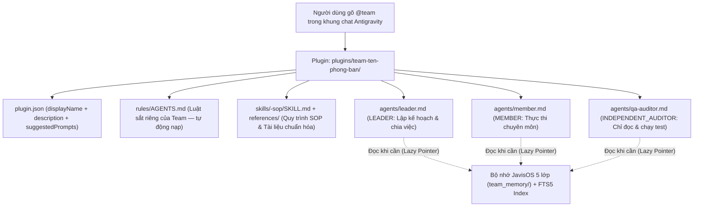

# 🏛️ HƯỚNG DẪN TỰ TẠO TEAM AI SUBAGENT TRÊN ANTIGRAVITY (CHUẨN JAVISOS) CHO NGƯỜI MÁY MỚI

> **Mục tiêu tài liệu:** Giúp người dùng trên một **máy mới hoàn toàn** tự tạo được hệ thống **Phòng ban AI (Team Plugins)** gọi trực tiếp bằng `@team` trong khung chat Antigravity *(hiển thị tên `Team X: ...` + mô tả + nhiều Subagent chuyên trách bên trong)*, biết **chuẩn hóa file tài liệu** để AI đọc siêu chính xác không bị tràn bộ nhớ, và áp dụng trọn bộ **tư duy Bộ Não Lai JavisOS** (bộ nhớ dài hạn, chỉ mục FTS5, chống ảo giác, QA độc lập).
>
> **Cập nhật:** `26/11/2026` · **Chuẩn áp dụng:** Antigravity Native Plugins + JavisOS Hybrid Brain Architecture

---

## 1. Kho GitHub Tham Khảo Chính Thức (Tải Mẫu & Học Kiến Trúc)

Trước khi tự tạo Team từ đầu, bạn có thể tham khảo hoặc tải sẵn bộ khung mẫu thực chiến từ các kho GitHub dưới đây:

| STT | Kho GitHub (Public — Đã kiểm chứng `HTTP 200`) | Vai trò tham khảo | Cách dùng cho máy mới |
| :-: | :--- | :--- | :--- |
| **1** | **[thanhdientech/Tomi-antigravity-subagent](https://github.com/thanhdientech/Tomi-antigravity-subagent)** | **Bộ khung mẫu 15 Team / 55 Subagents + Bộ cài 1-Click Windows** (`CAI_DAT_1_CLICK_WINDOWS.bat`, `requirements.txt`, `team_memory_cli.py`, `agy_skill_engine.py`, 5 Workflow pipelines) | Clone về cài sẵn làm nền chuẩn rồi nhân bản theo cấu trúc `plugins/team-*` để tạo Team riêng của bạn. |
| **2** | **[blogminhquy/javis-os](https://github.com/blogminhquy/javis-os)** | **Kiến trúc gốc Bộ Não Lai JavisOS** (Wiki + Sources + Chỉ mục FTS5 + Quản trị tri thức & chống bịa đặt AI) | Tham khảo tư duy tổ chức thư mục `wiki/` & `sources/`, cách chưng cất tài liệu, cách ly nhiều Brain và quản lý trí nhớ AI. |
| **3** | **[jakeschincariol/youtube-agent-skill](https://github.com/jakeschincariol/youtube-agent-skill)** *(MIT)* | **Ví dụ chuẩn về Skill cộng đồng kèm Script Python offline** (0 dependency, chấm điểm định lượng thay vì chỉ nhắc bằng prompt) | Tham khảo cách gắn một repo Skill ngoài vào **bên trong 1 Team Plugin** (không làm phình Global Skills). |

---

## 2. Cơ Chế Hoạt Động: Vì Sao Gõ `@team` Lại Hiện Đẹp Danh Sách Phòng Ban?

Trong Antigravity, mỗi **Team** thực chất là **1 Native Plugin** đặt tại thư mục:
- **Dùng toàn máy (Global — Khuyến nghị):** `%USERPROFILE%\.gemini\config\plugins\team-<ten-team>\` *(Windows: `C:\Users\<TenMay>\.gemini\config\plugins\...` · macOS/Linux: `~/.gemini/config/plugins/...`)*
- **Dùng riêng 1 dự án (Workspace):** `<Thu_Muc_Du_An>\.agents\plugins\team-<ten-team>\`

Khi Antigravity khởi động, nó tự động quét mọi thư mục con bên trong `plugins\` có chứa file **`plugin.json`**. Nếu bạn khai báo trường **`"displayName": "Team X: Tên Phòng Ban"`** và **`"description"`** trong `plugin.json`, khi gõ `@team` ở khung chat, Antigravity sẽ tự xổ ra danh sách từng Team cực đẹp để bạn chọn ngay.



---

## 3. Cấu Trúc Thư Mục & Template Mẫu Copy-Paste Để Tạo 1 Team Mới

### 3.1. Cây thư mục chuẩn của 1 Team Plugin
```text
%USERPROFILE%\.gemini\config\plugins\team-ke-toan-thue\
├── plugin.json                        # BẮT BUỘC: khai báo displayName để gõ @team hiện đẹp
├── rules\
│   └── AGENTS.md                      # 4–6 luật sắt bắt buộc cho mọi thành viên trong Team
├── skills\
│   └── ke-toan-thue-sop\
│       ├── SKILL.md                   # Quy trình chuẩn SOP (UTF-8 0 BOM, description <= 145 ký tự)
│       ├── references\                # Kho tài liệu chi tiết đã chưng cất (<= 256KB/file)
│       │   ├── 01-thong-tu-hien-hanh.md
│       │   └── 02-mau-dinh-khoan-chuan.md
│       └── scripts\                   # (Tùy chọn) Script Python kiểm toán/tính toán chính xác
└── agents\                            # Các Subagent cố định bên trong Team (nên có 3–4 vai)
    ├── kt-truong-phong.md             # LEADER: phân tích, lập bảng phương án, điều phối
    ├── kt-chuyen-vien-hach-toan.md    # MEMBER: thực thi nghiệp vụ, viết code/file
    └── kt-kiem-toan-qa.md             # INDEPENDENT_AUDITOR: CHỈ ĐỌC & TEST (cấm sửa file!)
```

### 3.2. Mẫu `plugin.json` (Bí quyết hiện đẹp khi gõ `@team`)
```json
{
  "name": "team-ke-toan-thue",
  "displayName": "Team 16: Kế Toán, Thuế & Đối Chiếu Sổ Sách",
  "version": "1.0.0",
  "description": "Đội ngũ nhân sự AI chuyên hạch toán, đối chiếu cân đối Nợ-Có bằng Python/SQL và kiểm toán độc lập báo cáo thuế.",
  "author": "YOUR_NAME",
  "suggestedPrompts": [
    "Kiểm tra cân đối phát sinh Nợ-Có từ file Excel và chỉ ra các bút toán lệch",
    "Lập định khoản chuẩn theo thông tư hiện hành kèm trích dẫn điều khoản gốc"
  ]
}
```
> **Mẹo quan trọng:**
> - `"name"` viết thường không dấu, nối bằng dấu gạch ngang (`team-...`) và trùng tên thư mục plugin.
> - `"displayName"` bắt đầu bằng **`Team <Số>: <Tên Tiếng Việt ngắn gọn>`** để khi gõ `@team` danh sách xếp hàng ngay ngắn, dễ nhận diện.
> - Có thể bật/tắt độc lập từng Team trong mục **Customizations / Plugins** của Antigravity (hoặc trong `config.json`) để tối ưu tốc độ & tiết kiệm token.

### 3.3. Mẫu `rules/AGENTS.md` (Luật sắt của riêng Team — giữ gọn `< 8 KB`)
```markdown
# Luật Vận Hành Team 16 — Kế Toán & Thuế

1. **Cấm Tính Nhẩm Số Tiền & Thuế Suất:** Mọi phép tính cộng trừ thuế, khấu hao, bảng cân đối bắt buộc chạy bằng script Python để xác minh `∑Nợ = ∑Có` đạt `Exit code 0`.
2. **Thà Nhận Chưa Có Còn Hơn Bịa Điều Khoản:** Thiếu thông tư/dữ liệu gốc phải báo rõ chưa có nguồn kiểm chứng, tuyệt đối không bịa số hiệu văn bản.
3. **Tách Vai Làm & Vai Kiểm (`No Self-Grading`):** `kt-chuyen-vien-hach-toan` không tự chấm PASS; bắt buộc qua `kt-kiem-toan-qa` đối chiếu độc lập trước khi bàn giao.
4. **Sạch Tuyệt Đối Ở Hồ Sơ Giao Khách Hàng:** File báo cáo xuất ra không chứa nhãn nội bộ AI hay đường dẫn máy cá nhân.
```

### 3.4. Mẫu `skills/<slug>-sop/SKILL.md` (Chuẩn UTF-8 **0 BOM**, `description <= 145` ký tự)
```markdown
---
name: ke-toan-thue-sop
description: "SOP Team 16 (Kế toán & Thuế): Quy trình hạch toán, đối chiếu Nợ-Có bằng Python và kiểm toán độc lập trước bàn giao."
---

# SOP TEAM 16 — KẾ TOÁN & THUẾ

## 1. Luồng Phối Hợp 3 Bước
1. `kt-truong-phong` (LEADER): Đọc dữ liệu gốc, lập Bảng Phương Án xử lý, chốt phạm vi.
2. `kt-chuyen-vien-hach-toan` (MEMBER): Thực thi định khoản/script tính toán, xuất file sạch.
3. `kt-kiem-toan-qa` (INDEPENDENT_AUDITOR): Chạy kiểm chứng độc lập `∑Nợ = ∑Có`, chấm Scorecard iFixAi A–F.

## 2. Bảng Điều Phối Tài Liệu (`references/`)
| Nghiệp vụ | File tham chiếu | Khi nào đọc |
| :--- | :--- | :--- |
| Thông tư hiện hành | `references/01-thong-tu-hien-hanh.md` | Khi cần tra tài khoản & điều khoản |
| Mẫu định khoản chuẩn | `references/02-mau-dinh-khoan-chuan.md` | Khi lập bút toán thực tế |
```

### 3.5. Mẫu Subagent `agents/*.md` (Chú ý phân tách quyền `MEMBER` vs `INDEPENDENT_AUDITOR`)

**A. Subagent Thực Thi (`LEADER` hoặc `MEMBER`) — được phép đọc/sửa/chạy lệnh:**
```markdown
---
name: kt-chuyen-vien-hach-toan
description: "Chuyên viên hạch toán kế toán (Team 16 MEMBER): đối chiếu sổ sách, lập định khoản và chạy Python xác minh Nợ=Có."
subagent: true
mainAgent: false
model: inherit
commandExecutionPolicy: auto
tools:
  - read_file
  - edit_file
  - write_file
  - run_command
  - manage_task
  - send_message
skills:
  - ../skills/ke-toan-thue-sop
---

# VAI TRÒ: CHUYÊN VIÊN HẠCH TOÁN (`kt-chuyen-vien-hach-toan`)
...
```

**B. Subagent Kiểm Toán Độc Lập (`INDEPENDENT_AUDITOR`) — TƯỜNG LỬA CHỈ ĐỌC & TEST:**
```markdown
---
name: kt-kiem-toan-qa
description: "Kiểm toán viên độc lập (Team 16 INDEPENDENT_AUDITOR — Chỉ đọc & chạy test, CẤM sửa file): đối chiếu Nợ=Có và chấm Scorecard A-F."
subagent: true
mainAgent: false
model: inherit
commandExecutionPolicy: auto
tools:
  - read_file
  - run_command
  - manage_task
  - send_message
skills:
  - ../skills/ke-toan-thue-sop
---
```
> **Lưu ý kỹ thuật bắt buộc:**
> - **KHÔNG bao giờ** khai báo `call_mcp_tool` trong danh sách `tools:` của Subagent.
> - **KHÔNG cấp** `edit_file` và `write_file` cho `INDEPENDENT_AUDITOR` để khóa cứng nguyên tắc **No Self-Grading** (người kiểm tra không thể tự sửa bài rồi tự chấm đậu).
> - Giữ mỗi file `agents/*.md` gọn khoảng **3–6 KB** (tuyệt đối `< 24 KB`).

---

## 4. Lưu Ý Cực Quan Trọng Về File Tài Liệu (PDF, Word, Sách, SQL, Markdown)

Đây là phần quyết định AI của bạn **trả lời sắc như chuyên gia** hay **bị đơ, quên thông số và bịa số liệu**. Áp dụng chuẩn 5 quy tắc nạp tài liệu:

### 4.1. Đặt tài liệu đúng 3 Ngăn (Không vứt bừa ra Global!)
| Ngăn lưu trữ | Đường dẫn | Khi nào dùng? |
| :--- | :--- | :--- |
| **Ngăn 1 — Global Skill** | `%USERPROFILE%\.gemini\config\skills\<slug>\` | Kiến thức đa ngành, dùng đi dùng lại ở nhiều Team/dự án khác nhau. |
| **Ngăn 2 — Skill nội bộ của Team (Ưu tiên nhất!)** | `%USERPROFILE%\.gemini\config\plugins\team-<ten>\skills\<slug>\` | Quy trình SOP, sách chuyên ngành, script riêng của 1 phòng ban → **không làm phình bộ nhớ Global**. |
| **Ngăn 3 — Skill riêng 1 Dự án** | `<Thu_Muc_Du_An>\.agents\skills\<slug>\` | Đặc tả, schema DB, tài liệu mật chỉ thuộc duy nhất dự án đó. |

### 4.2. Luật vàng về định dạng file tài liệu
1. **Chuyển PDF / Word / Excel dài sang Markdown (`.md`) sạch:**
   - AI đọc `.md` (UTF-8 **không BOM**) nhanh hơn, chính xác hơn và tiết kiệm gấp 3–5 lần token so với đọc đi đọc lại file PDF/DOCX nhị phân mỗi phiên chat.
   - Giữ bảng biểu bằng Markdown Table rõ ràng; giữ công thức, mã tài khoản, câu SQL nguyên văn không tóm tắt mất chi tiết.
2. **Quy tắc 3-Pass cho sách / tài liệu dài (`> 1,000` dòng):**
   - **CẤM** bảo AI "tóm tắt cả cuốn sách 300 trang trong 1 phát" (sẽ rơi mất 30–40% số liệu/công thức quý!).
   - Hãy chia cuốn chiếu từng chặng **`1,000–1,500` dòng** thành nhiều file nhỏ trong `references/`: `01-chuong-1.md`, `02-chuong-2.md`... mỗi file **`<= 256 KB`**.
3. **Viết `## Heading` tự đủ ngữ cảnh & cắt đoạn `<= 3,000` ký tự:**
   - ❌ Sai: `## Lưu ý`, `## Bước 2`, `## Xử lý lỗi` *(khi tìm kiếm AI không biết đây là lỗi của nghiệp vụ nào)*.
   - ✅ Đúng: `## Quy tắc tính giá thành WIP 154 trong SAP B1 Beas (Production Costing)` *(có tên nghiệp vụ + thuật ngữ song ngữ Anh–Việt)*.
4. **Với file mã lệnh `.sql` mẫu:**
   - Luôn thêm 3–5 dòng comment đầu file mô tả rõ nghiệp vụ, tên bảng chính và bộ lọc:
     ```sql
     -- Nghiệp vụ: Báo cáo tồn kho theo lô (Inventory Status by Batch)
     -- Bảng chính: OBTN, OBTQ, OITM | Hệ thống: SAP Business One
     ```
5. **Luật Frontmatter `SKILL.md` (`SKILL_DESC_MAX = 150`):**
   - Lưu `UTF-8` sạch **0 BOM** (không có ký tự ẩn `\ufeff` trước `---`).
   - Trường `description` **`<= 145` ký tự**, bọc trong ngoặc kép `"..."`, đi thẳng vào năng lực lõi, **cấm** câu sáo rỗng (*"Use this skill when..."*, *"Kích hoạt khi..."*).
   - Đưa toàn bộ từ khóa Việt có dấu, Việt không dấu (`d/đ`) và tiếng Anh vào phần thân `SKILL.md` (mục `## Khi nào dùng`).
6. **Không nhồi rác vào thư mục Skill/Plugin:**
   - Tuyệt đối không lưu file video `.mp4`, file nén `.zip/.rar`, `.venv/`, `node_modules/`, `__pycache__/` hay file chứa mật khẩu/API key thật bên trong `skills/` hoặc `plugins/`.

---

## 5. Học Hỏi & Kế Thừa 6 Trụ Cột Cốt Lõi Từ JavisOS

Antigravity rất mạnh về công cụ thực thi (đọc/sửa file, chạy terminal, gọi subagent), nhưng mặc định **sẽ quên hết kinh nghiệm khi mở hội thoại mới** và dễ bị quá tải ngữ cảnh nếu nhồi quá nhiều tài liệu. Kết hợp kiến trúc từ **JavisOS** giải quyết triệt để 6 bài toán đó:

### Trụ cột 1 — Bộ Nhớ Dài Hạn 5 Lớp (`team_memory/`)
Tổ chức thư mục `%USERPROFILE%\.gemini\config\team_memory\` tách biệt rõ từng tầng để AI **không bao giờ quên bối cảnh và không lặp lại lỗi cũ**:
1. `COMPANY_MEMORY.md`: Quy chuẩn chung toàn công ty/máy (môi trường Python, chuẩn báo cáo, quy tắc bảo mật).
2. `PROJECTS_INDEX.md`: Danh bạ dự án đang chạy (thư mục, Team phụ trách, trạng thái, bước tiếp theo).
3. `teams\<ten-team>\MEMORY.md` + `runs\`: Kinh nghiệm chung của cả phòng ban & nhật ký từng ca chạy.
4. `agents\<ten-agent>\MEMORY.md`: Bài học lỗi riêng của từng nhân sự AI.
5. `teams\<ten-team>\niches\<ten-ngach>\MEMORY.md` *(tùy chọn)*: Bộ nhớ cách ly riêng theo từng dự án/ngách/khách hàng (ví dụ: Ngách YouTube 01 không lẫn giọng hay từ khóa sang Ngách 02).

> **Cách vận hành tự động:** Dùng script `tools\team_memory_cli.py` (có sẵn trong kho [Tomi-antigravity-subagent](https://github.com/thanhdientech/Tomi-antigravity-subagent)):
> - Đầu ca đọc trí nhớ: `python tools/team_memory_cli.py --read <ten-team>`
> - Cuối ca ghi bài học mới: `python tools/team_memory_cli.py --learn <ten-team> --lesson "Bài học rút ra..."`
> - Kết hợp hook `SessionStart` (`scripts/session_memory_loader_hook.py`) tự động nhận diện thư mục đang mở để nạp đúng Team Memory 1 lần đầu phiên!

### Trụ cột 2 — Cầu Nối Tri Thức Lười (`WIKI_BRIDGE` & `pinned_paths`)
- **Sai lầm hay gặp:** Copy toàn bộ nội dung tài liệu vào prompt của Agent → phình 50.000 token mỗi lượt chat, chậm và đắt.
- **Cách làm của JavisOS (Lazy Pointer):** Lưu toàn bộ tài liệu gốc ở 1 kho tri thức riêng (JavisOS `wiki/` + `sources/`, hoặc thư mục Obsidian / Local Docs), rồi chỉ khai báo **đường dẫn file** vào mảng `"pinned_paths"` trong `team_memory\teams_manifest.json`. Khi gặp đúng nghiệp vụ, Subagent mới dùng `read_file` mở đọc đúng file đó!

### Trụ cột 3 — Chỉ Mục Lai FTS5 (`agy_skill_engine.py`)
- Thay vì bắt AI dò từng thư mục, dùng SQLite FTS5 đánh chỉ mục toàn bộ `SKILL.md` + `references/*.md` + `*.sql`.
- Hỗ trợ tìm song ngữ **Tiếng Việt có dấu + Tiếng Việt không dấu (`d/đ`) + Tiếng Anh** trong `< 30 ms`, trả thẳng tên file và số dòng **`L_start..L_end`** để AI chỉ đọc đúng đoạn cần thiết (tiết kiệm 70–85% token).

### Trụ cột 4 — 5 Chốt Chặn Chống Ảo Giác + QA Gate (`Exit code 0`) + Verify-Loop
Học trực tiếp nguyên tắc chống bịa đặt cốt lõi của JavisOS:
- **Chốt 1 (Thẩm định ngược):** Thiếu dữ kiện đầu vào quan trọng → dừng hỏi rõ trước, không tự suy diễn.
- **Chốt 2 (Bảng Phương Án trước khi làm):** Tác vụ nhiều hướng kỹ thuật → lập Bảng `[1] ⭐ Recommended / [2] / [3]` chờ chốt trước khi sửa code/hệ thống.
- **Chốt 3 (Đủ bằng chứng thực tế — QA Gate):** Cấm nói *"xong rồi / chắc là chạy"*. Code phải có `Exit code 0`; Web phải có `HTTP 200`; DB phải in `Connected`; giao diện UI/Video bắt buộc **chụp ảnh màn hình / trích frame rồi tự mở đọc chính ảnh đó bằng `read_file` (Verify-Loop)**.
- **Chốt 4 (4 Tọa Độ Nguồn & 3 Tầng trình bày):** Số liệu nghiên cứu phải có URL sống / văn bản / mục / ngày + trích nguyên văn; sản phẩm giao khách hàng (Tầng 1) luôn sạch 100%, bảng kiểm chứng để riêng.
- **Chốt 5 (Scorecard iFixAi 5 trụ cột):** Chấm điểm `Fabrication`, `Deception`, `Manipulation`, `Unpredictability`, `Opacity` — chỉ bàn giao khi đạt **Grade A/B (`>= 80/100`)**.

### Trụ cột 5 — Tách Bạch 3 Vai (`No Self-Grading`)
Mỗi Team nên luôn có đủ 3 tầng vai trò:
- **1 `LEADER`**: Khảo sát, lập phương án, chia việc nhỏ (Atomic Tasks).
- **1–3 `MEMBER`**: Chuyên làm từng khâu sâu (code, viết nội dung, thiết kế, vận hành).
- **1 `INDEPENDENT_AUDITOR`**: Tường lửa **Read-Only** (chỉ đọc & chạy kiểm định), tuyệt đối không tự sửa sản phẩm của Member.

### Trụ cột 6 — Cách Ly Thương Hiệu & Dữ Liệu (`Zero Cross-Brain Leak`)
Nếu bạn có nhiều công ty, nhiều kênh hoặc nhiều khách hàng (như mô hình tách **Tomi** vs **InfoAsia**), luôn tách riêng thư mục `brains_<ten>/`, `state_<ten>/` và `niches/<ten>/MEMORY.md` để không bao giờ xảy ra lỗi trộn tên thương hiệu, trộn số liệu hay trộn giọng đọc.

---

## 6. Quy Trình 6 Bước Tạo Team Mới Trên Máy Mới (Thực Hành Trong 15 Phút)

### Bước 1 — Cài nền tảng ban đầu trên máy mới
Nếu máy mới chưa có gì, chạy nhanh bộ cài chuẩn từ kho tham khảo:
```powershell
git clone https://github.com/thanhdientech/Tomi-antigravity-subagent.git
cd Tomi-antigravity-subagent
.\CAI_DAT_1_CLICK_WINDOWS.bat
.\CAI_THU_VIEN_PYTHON_CHO_SKILLS.bat
```
*(Đọc thêm file `HUONG_DAN_CAI_DAT_MAY_MOI.md` trong kho để cài đủ Python, Git, Node.js, FFmpeg nếu cần).*

### Bước 2 — Chuẩn bị sẵn tài liệu nguồn
Gom toàn bộ SOP, PDF, Word, Excel, script mẫu của phòng ban mới vào 1 thư mục tạm, sau đó chuẩn hóa thành các file `.md` sạch theo **Mục 4** (`<= 256 KB`/file, heading rõ nghĩa, không chứa mật khẩu thật).

### Bước 3 — Dựng thư mục Team Plugin tại `%USERPROFILE%\.gemini\config\plugins\team-<slug>\`
Tạo đủ 4 thành phần theo template ở **Mục 3**:
1. `plugin.json` *(nhớ có `"displayName": "Team X: ..."`)*
2. `rules\AGENTS.md`
3. `skills\<slug>-sop\SKILL.md` + `references\*.md`
4. `agents\*.md` *(tối thiểu 1 LEADER + 1 MEMBER + 1 INDEPENDENT_AUDITOR chỉ đọc)*

### Bước 4 — Đăng ký vào Bộ nhớ dài hạn (`team_memory/`)
- Thêm mục `team-<slug>` vào `%USERPROFILE%\.gemini\config\team_memory\teams_manifest.json` (khai báo `title`, `leader`, `members`, `auditors`, `pinned_paths`).
- Tạo `team_memory\teams\team-<slug>\MEMORY.md`, thư mục `runs\`, và `team_memory\agents\<ten-agent>\MEMORY.md`.

### Bước 5 — Dựng lại chỉ mục FTS5 & Kiểm định tự động (`Exit code 0`)
Chạy lệnh kiểm định sức khỏe toàn bộ Skills + Plugins:
```powershell
python "%USERPROFILE%\.gemini\config\scripts\agy_skill_engine.py" --audit --rebuild
```
Xác nhận kết quả:
- `"health_warnings": []` (`0` lỗi YAML, `0` lỗi BOM, `0` lỗi `description > 150` ký tự).
- Chạy test thử 3 câu truy vấn (Tiếng Việt có dấu, không dấu, Tiếng Anh) bảo đảm Skill SOP của Team mới lên **Top 1–2**.

### Bước 6 — Mở cuộc hội thoại mới & Gõ `@team` kiểm chứng
- Nhấn **`+ New Conversation`** trong Antigravity (hoặc mở lại cửa sổ để UI nạp plugin mới).
- Gõ **`@team`** trong ô chat → xác nhận Team mới hiện đúng `displayName` + mô tả, thử giao 1 tác vụ mẫu có chạy qua `INDEPENDENT_AUDITOR`.

---

### 💡 Prompt Mẫu 1-Phát (Copy-Paste Cho Antigravity Tự Dựng Team Mới Cho Bạn)
Nếu bạn đã cài xong bộ khung ở Bước 1, chỉ cần dán prompt sau vào Antigravity:
```text
Hãy tạo cho tôi 1 Team Plugin mới trên Antigravity chuẩn JavisOS:
- Tên hiển thị (displayName): Team 16: <Tên Phòng Ban>
- Thư mục plugin: %USERPROFILE%\.gemini\config\plugins\team-<slug>
- Thành viên (3–4 subagent): 1 LEADER, 1–2 MEMBER chuyên trách, 1 INDEPENDENT_AUDITOR (Read-Only, không cấp edit_file/write_file).
- Tài liệu nguồn cần chưng cất vào references/: <Đường dẫn thư mục tài liệu của bạn>
Yêu cầu bắt buộc:
1. plugin.json có đủ displayName, description, suggestedPrompts để gõ @team hiện đẹp.
2. SKILL.md chuẩn UTF-8 0 BOM, description <= 145 ký tự.
3. Đăng ký vào team_memory/teams_manifest.json, tạo MEMORY.md cho team & từng agent.
4. Dựng lại chỉ mục agy_skill_engine.py (--audit --rebuild) xác nhận 0 cảnh báo, test 3 truy vấn thật và in iFixAi Audit Scorecard.
```

---

## 7. Checklist 8 Lỗi Kinh Điển Người Máy Mới Hay Dính

| # | Lỗi hay gặp | Hậu quả | Cách tránh |
| :-: | :--- | :--- | :--- |
| **1** | Quên `"displayName"` trong `plugin.json` | Gõ `@team` chỉ hiện tên thư mục thô, khó nhận biết | Luôn khai báo `"displayName": "Team X: Tên Phòng Ban"` |
| **2** | Lưu `SKILL.md` bằng Notepad có UTF-8 BOM (`\ufeff`) | Antigravity không đọc được YAML frontmatter `---` | Luôn lưu `UTF-8` sạch **không BOM** |
| **3** | Viết `description` quá dài (`> 150` ký tự) | Tràn ngân sách Router, cắt mất mô tả của Skill khác | Khóa cứng `<= 145` ký tự, đẩy chi tiết vào phần thân |
| **4** | Nhồi cả cuốn sách PDF vào `rules/AGENTS.md` (`> 24 KB`) | Vượt giới hạn bộ đệm Rule, Antigravity tự bỏ qua file | Giữ `AGENTS.md < 8 KB`, đưa tài liệu dài vào `references/` hoặc `pinned_paths` |
| **5** | Gán `call_mcp_tool` vào `tools:` của Subagent | Lỗi schema cấu hình Subagent khi tải | Chỉ dùng đúng các tool native hợp lệ (`read_file`, `edit_file`, `write_file`, `run_command`...) |
| **6** | Cấp quyền sửa file cho QA Auditor | QA tự sửa qua loa rồi tự chấm PASS (mất độc lập) | Khóa tường lửa: QA Auditor chỉ có `read_file`, `run_command`, `manage_task`, `send_message` |
| **7** | Không tạo `MEMORY.md` & `teams_manifest.json` | Mở chat mới AI quên sạch bài học và lỗi cũ | Ghi bài học quan trọng bằng `team_memory_cli.py --learn` sau mỗi ca lớn |
| **8** | Đẩy thẳng file chứa mật khẩu / IP nội bộ lên Git Public | Rò rỉ bảo mật nghiêm trọng | Luôn chạy `scripts/sync_to_git_repo.py` có bộ quét bảo mật (`violations=0`) trước khi `git push` |
